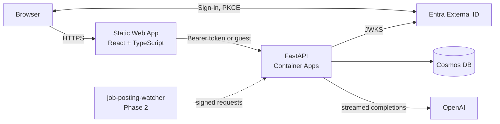
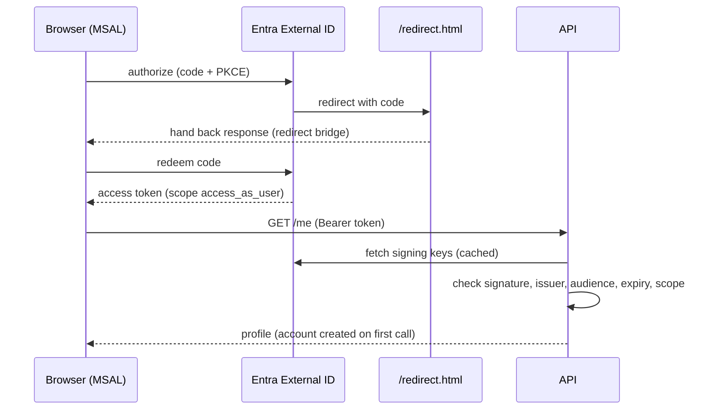

# AI Job Application Assistant

Tailor your resume to a job description in seconds. Paste or upload a resume and a job
posting, and get a candid match score, specific rewrites that never invent experience, and a
cover letter draft, streamed as they are written. Sign in to keep several resume versions and
get a larger daily allowance.

**Live demo:** <https://agreeable-field-0639e271e.7.azurestaticapps.net> (no account needed)
· **Companion service:** `job-posting-watcher` (ingests postings from public job boards; Phase 2)

> Status: Phase 1 of 3 (accounts, spend protection, infrastructure as code). Screenshots and a
> short demo GIF arrive with the Phase 3 UI pass.

## What you can do

- **Analyze a resume** against a job description: match score, strengths and gaps,
  section-by-section feedback, and a complete tailored rewrite.
- **Draft a cover letter** for the same role.
- **Upload PDF or DOCX** (scanned PDFs are read with OCR) or paste text; edit before generating.
- **Save resumes** (signed in): keep versions, choose a default, reuse without re-uploading.
- **Stay in control**: see today's remaining generations; delete your account and everything
  saved with it from Settings.

## How it works



1. The browser sends the resume and job description to the API (signed in or as a guest).
2. The API checks the per-IP rate limit, the caller's daily quota, and the global daily budget.
3. It streams the model's Markdown back over Server-Sent Events and records token usage.
4. Signed-in users' results are stored; guest results are not.

---

## For engineers

### Repository layout

```
backend/            FastAPI app (Python 3.12)
  app/core/         settings, problem+json errors, logging, client IP
  app/auth/         token validation (Entra), dev auth, principals
  app/api/          routers, schemas, middleware, dependency wiring
  app/domain/       pure rules: rate limiting, pricing, usage, resumes, users
  app/services/     use cases: quotas & budget, resumes, accounts
  app/repositories/ interfaces + in-memory and Cosmos implementations
  app/integrations/ OpenAI streaming client (with mock mode)
  app/parsing/      PDF/DOCX extraction with OCR fallback
  tests/unit, tests/integration
frontend/           React 19 + TypeScript + Vite, Tailwind, Radix UI, TanStack Query, MSAL
infra/azure         Terraform for Azure (imports the existing resources)
infra/entra         Terraform for the External ID app registrations
docs/adr            architecture decision records
docs/setup          setup guides
```

Rules the code follows: routers stay thin; `domain/` has no FastAPI or Cosmos imports; every
repository has an in-memory implementation used by tests and local mode.

### Run it locally (mock mode, 3 commands)

```bash
git clone https://github.com/salmanfs815/ai-job-app-assist.git
```

```bash
cd ai-job-app-assist
```

```bash
docker compose up --build
```

Open <http://localhost:3000>. No OpenAI key, Azure account or identity provider is needed:
output is deterministic sample text and **Sign in** uses a local "Demo User". Live-reload
setup, the Cosmos emulator and every setting: [docs/setup/local-development.md](docs/setup/local-development.md).

### Sign-in sequence



### API

| Endpoint | Who | Notes |
| --- | --- | --- |
| `GET /health` | anyone | never rate limited |
| `POST /resume/extract`, `POST /job-description/extract` | guest or user | multipart upload; text only is returned, files are discarded |
| `POST /generate/resume-suggestions`, `POST /generate/cover-letter` | guest or user | SSE stream: `status`, `delta`, `done`, `error` |
| `GET /quota` | guest or user | today's allowance and whether generation is available |
| `GET /me`, `DELETE /me` | user | profile; delete the account and all its data |
| `GET/POST /resumes`, `GET/PATCH/DELETE /resumes/{id}` | user | saved resume text and metadata |

Interactive docs: `/docs`. Errors are RFC 9457 `application/problem+json` with a stable
`code`; `429` and `503` carry `Retry-After`. Reference: [docs/errors.md](docs/errors.md).

### Limits and spend protection

| Layer | Default | When exceeded |
| --- | --- | --- |
| Per-IP token bucket (all endpoints) | burst 60, 1 req/s; uploads and generations cost 10 | `429` + `Retry-After` |
| Generations per day | 3 per guest IP, 20 per user | `429` + `Retry-After` until 00:00 UTC |
| Global LLM budget | USD 1.00 per UTC day (estimated from token usage) | `503` + `Retry-After`; non-LLM features keep working |

Design and trade-offs: [ADR 0003](docs/adr/0003-rate-limiting-and-spend-protection.md).

### Data model (Cosmos DB for NoSQL)

| Container | Partition key | Holds |
| --- | --- | --- |
| `users` | `/id` | one document per account |
| `resumes` | `/userId` | extracted resume text and metadata (never the file) |
| `usage` | `/userId` | one counter document per owner per UTC day; `userId = "global"` for the budget; per-item TTL |
| `results` | `/type` | generated results of signed-in users (existing container) |

Why these keys, and why the account is serverless today: [ADR 0004](docs/adr/0004-cosmos-partitioning-and-throughput.md).

### Testing and CI

- Backend: ruff, mypy (strict on `domain`, `services`, `auth`), pytest with a coverage gate of
  85% on `domain`, `services` and `auth` (currently 99%). Auth tests sign JWTs locally and
  serve them from a fake JWKS.
- Frontend: TypeScript strict, ESLint (with jsx-a11y), Prettier, Vitest + Testing Library.
- Workflows: backend tests gate the image build and Container Apps rollout; frontend checks gate
  the Static Web Apps deploy; Terraform is planned on PRs (plan posted as a comment) and applied
  from `master` after approval on the `production` environment.

### Infrastructure as code

All Azure resources are in Terraform and were **imported**, not recreated: a read-only plan
against production shows `7 to import, 0 to add, 0 to change, 0 to destroy`. Phase 1 changes
land as a second, separately reviewed plan. Guide: [docs/setup/terraform.md](docs/setup/terraform.md);
decision: [ADR 0008](docs/adr/0008-terraform-with-imported-resources.md).

### Security and privacy

- **Stored:** account ID, email and display name from the identity provider; saved resume text;
  generated results of signed-in users; daily usage counters.
- **Not stored:** uploaded files, guest results, raw IP addresses (guests are counted by a
  salted hash that expires after two days), passwords (handled by Entra External ID).
- **Not logged:** resume or job-description text, tokens.
- **Deleting your data:** Settings → Delete account removes resumes, results and usage records.
- The OpenAI key never reaches the browser. Generated Markdown is rendered without raw HTML.
- Development sign-in cannot be enabled outside `ENVIRONMENT=local`; the API refuses to start.

### Configuration

Every variable is documented in [`.env.example`](.env.example). Sign-in setup:
[docs/setup/entra-external-id.md](docs/setup/entra-external-id.md).

### Decisions

See the [ADR index](docs/adr/README.md): auth provider, guest mode, rate limiting and spend
protection, Cosmos partitioning, service-to-service auth, Terraform with imports.

### Roadmap

- **Phase 2:** watchlist of company job boards (Greenhouse, Lever, Ashby), ingestion from the
  watcher, a feed of matching postings with on-demand scoring, baseline tracing.
- **Phase 3:** application tracking, personal insights, admin analytics, accessibility and UI
  polish, Playwright end-to-end tests, OpenTelemetry LLM spans.
